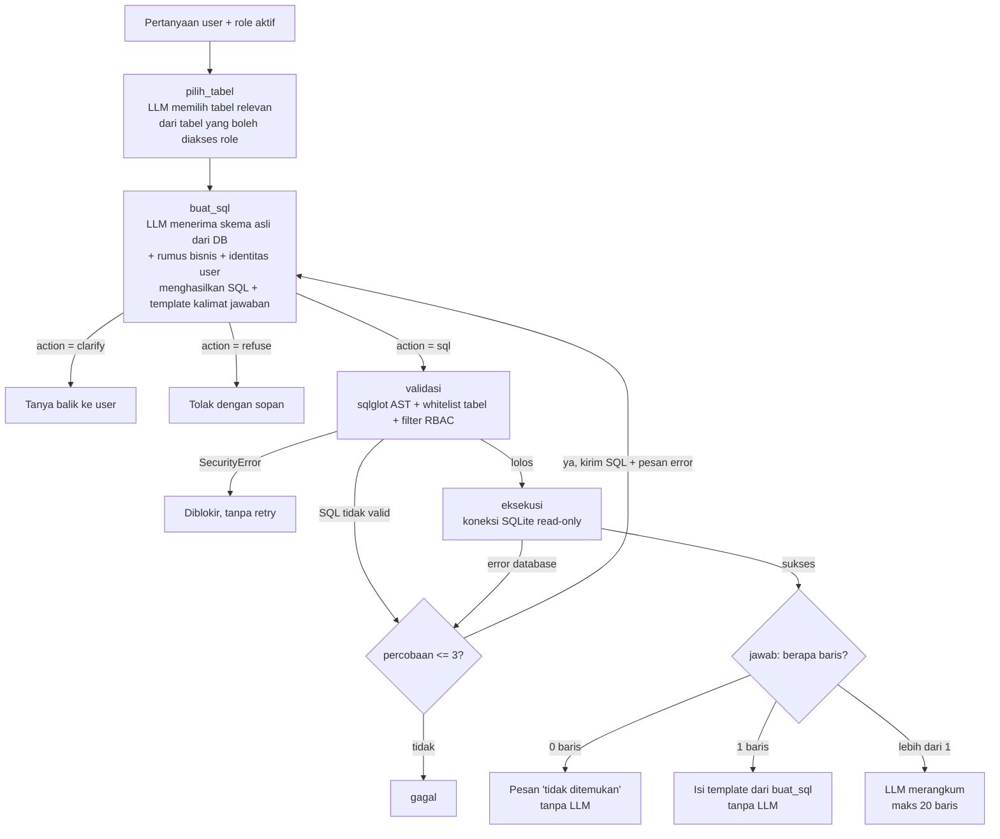

# Arsitektur

## Alur inferensi (LangGraph)



## Prompt template

Ketiga prompt (`TABLE_PROMPT`, `SQL_PROMPT`, `ANSWER_PROMPT`) adalah `ChatPromptTemplate` dari LangChain yang dikumpulkan di bagian atas `agent.py`. Placeholder seperti `{schema}`, `{role}`, `{question}`, dan `{retry_note}` diisi otomatis setiap ada pertanyaan. Inilah *dynamic prompting*: isi prompt berbeda untuk setiap user, pertanyaan, dan tabel yang dipilih.

## Penghematan request

Free tier Gemini hanya memberi 20 request/hari per model, jadi jumlah panggilan LLM per pertanyaan dijaga sekecil mungkin:

| Hasil query | Panggilan LLM | Cara menjawab |
|---|---|---|
| Ditolak / klarifikasi | 2 | Pesan dari `buat_sql` |
| 0 baris | 2 | Pesan tetap "data tidak ditemukan" (Sales: ditambah keterangan hak akses) |
| 1 baris | 2 | Template kalimat yang **ditulis LLM** di `buat_sql` (contoh: `"Sisa pokok Budi adalah Rp {SisaPokok}"`), lalu diisi nilai dari database oleh kode |
| Lebih dari 1 baris | 3 | LLM merangkum, maksimal 20 baris dikirim |

Template kalimat ini **bukan** "string-template routing" yang dilarang soal. Template ditulis ulang oleh LLM untuk setiap pertanyaan, bersamaan dengan SQL-nya. Kode hanya memasukkan angka hasil query ke placeholder. Kalau placeholder tidak cocok dengan nama kolom, atau ada nilai kosong (NULL), jawaban otomatis dirangkum LLM.

## Self-correction loop

Kalau SQL tidak bisa di-parse (`InvalidSQLError`) atau database mengembalikan error, state menyimpan `error`, lalu router mengembalikan alur ke node `buat_sql`. Prompt berikutnya berisi SQL yang gagal beserta pesan error-nya, dan LLM diminta memperbaikinya. Perbaikan maksimal `MAX_RETRY = 3` kali. Pelanggaran keamanan (`SecurityError`) **tidak** di-retry, supaya LLM tidak "belajar" mencari celah.

## Pertahanan berlapis

| Lapisan | Di mana | Menangkal |
|---|---|---|
| 1. Instruksi prompt | `agent.py` → `buat_sql` | LLM menolak permintaan mutasi data, ganti role, atau baca data akun |
| 2. Parser AST (`sqlglot`) | `guard.py` | Lebih dari 1 statement (`; DROP ...`), perintah selain SELECT, node mutasi tersembunyi |
| 3. Whitelist tabel per role | `guard.py` → `ROLE_TABLES` | `System_Users`, `sqlite_master`, prefix schema (`main.`), CTE yang menyamar jadi tabel asli |
| 4. Penulisan ulang RBAC | `guard.py` → `apply_sales_filter` | Sales membaca kontrak, tagihan, atau denda milik sales lain |
| 5. Koneksi read-only | `database.py` → `mode=ro` | Apa pun yang lolos lapisan 1–4 tetap tidak bisa mengubah data |

Lapisan 1 boleh saja ditembus oleh prompt injection. Lapisan 2–5 adalah kode biasa yang tidak bisa dibujuk oleh LLM.

## Cara kerja RBAC

Filter untuk Sales **tidak** diserahkan ke LLM. Setelah SQL lolos validasi, setiap referensi tabel sensitif di AST diganti dengan subquery yang sudah difilter:

```sql
-- SQL dari LLM
SELECT CustomerName FROM Sales_Contracts sc WHERE sc.CustomerName = 'Siti Rahma'

-- SQL yang benar-benar dijalankan untuk sales_bambang (AgentID 101)
SELECT CustomerName FROM (SELECT * FROM Sales_Contracts WHERE SalesAgentID = 101) AS sc
WHERE sc.CustomerName = 'Siti Rahma'
```

`Payment_Schedules` dan `Late_Fee_Penalties` difilter lewat `ContractID IN (kontrak milik agent)`.

## Keputusan desain

| Hal | Keputusan | Alasan |
|---|---|---|
| Hak akses Sales | `Units`, `Sales_Contracts`, `Payment_Schedules`, `Late_Fee_Penalties` (difilter) | Sesuai soal: unit, harga, jadwal tagihan, denda, dan kontrak miliknya sendiri |
| `Payments_Received` untuk Sales | Ditolak | Soal melarang Sales melihat mutasi kas bank finance |
| Role Auditor | Read-only seluruh tabel transaksi | Tidak diatur di soal; auditor umumnya perlu melihat semua transaksi |
| `System_Users` | Ditolak untuk semua role | Tabel autentikasi tidak dibutuhkan untuk pertanyaan bisnis |
| Database | SQLite | Gratis, tanpa server, cocok untuk Streamlit Cloud |
| LLM | Google Gemini (`gemini-3.8-flash`), bisa diganti lewat `LLM_MODEL` | Model terbaru yang tersedia di Free tier. `init_chat_model` dari LangChain membuat model bisa diganti tanpa mengubah kode |
| Model cadangan | 3.6 Flash → 3.5 Flash → 3.5 Flash-Lite lewat `with_fallbacks` dari LangChain | Saat dites, 3.8 Flash sering menolak dengan 503 "high demand", dan Free tier hanya memberi 20 request/hari **per model**. Rantai cadangan membuat agent otomatis pindah model ketika satu model sibuk atau kuotanya habis |
